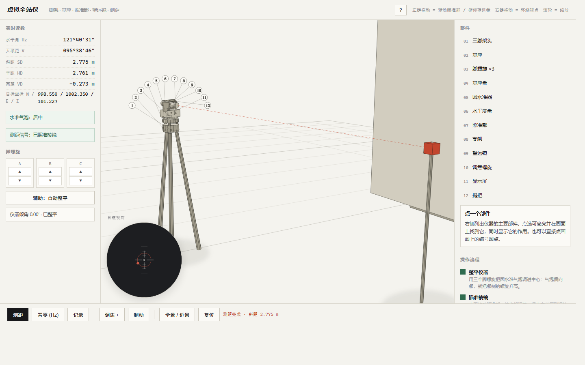

# 虚拟全站仪 · 浏览器交互模拟

一个零依赖的全站仪模拟器：整平、瞄准、目镜视野、测距、置零、记录坐标，全部由同一套三维几何逐帧算出。单个 HTML 文件，双击即用，也可直接部署到 GitHub Pages。



## 它能做什么

| 模块 | 交互 | 数值来源 |
|---|---|---|
| 整平 | 三个脚螺旋 A/B/C 各自升降，仪器随螺旋平面倾斜 | 三螺旋高度拟合平面的法线，换算成倾角（角分） |
| 瞄准 | 拖动画面转动照准部、俯仰望远镜；方向键微调 | 照准部偏航角 + 望远镜俯仰角 |
| 目镜视野 | 左下圆形取景器实时重绘目标、十字丝、测距光点 | 同一场景用 1.9° 视场重投影 |
| 测距 | 未照准时拒绝并提示；照准后输出斜距/平距/高差 | 视点到棱镜的真实三维距离 |
| 置零 | 把当前视线设为 0°00′00″ | 水平角基准偏置 |
| 记录 | 写入观测表并换算 N/E/Z 坐标 | 测站坐标 + 平距 × 方向角 |
| 讲解 | 12 个部件编号环列，点编号或右侧列表出介绍卡 | — |
| 引导 | 五步流程自动打钩：整平 → 瞄准 → 测距 → 置零 → 记录 | 事件驱动 |

## 操作

- **左键拖动**：横向转照准部，纵向俯仰望远镜
- **右键 / Shift + 拖动**：环绕观察视点
- **滚轮**：推拉视距
- **← → ↑ ↓**：微调照准（按住 Shift 步长更小）
- **Z / M / R**：置零 / 测距 / 记录
- **脚螺旋 A/B/C**：气泡偏向哪边，就升哪边——气泡往高处跑

页面右上角的 `?` 有同一份说明，另外列出了模拟边界。

## 数值是怎么来的

没有预录动画，也没有查表。每一帧：

1. 三个脚螺旋的高度拟合出一个平面，取它的法线，得到仪器的倾斜角；
2. 倾斜 → 照准部偏航 → 望远镜俯仰，三个变换串成父子链（`body → alidade → telescope`）；
3. 望远镜原点和视线方向从这条链上取出，与棱镜位置比较：夹角小于 0.35° 判定为已照准；
4. 测距返回视点到棱镜的真实距离，按水平角换算成目标坐标。

所以改任何一个输入，气泡、角度、距离、坐标会一起变——这也是它的教学价值所在：整平没做好，水平角就是偏的。

## 简化与边界

- 仪器是形似的简化几何体（约 12 个主要部件、50 余个几何体），不是 CAD 精度模型。
- 测距是理想模型：没有加常数、棱镜常数、气象改正与相位噪声，也没有照准误差。2″ 级仪器在这里表现为"完全精确"。
- 只有单测站、单目标：没有对中、后视定向、导线、放样，也没有数据导出（记录仅存在页面内，刷新即失）。
- 渲染用的是自写透视投影 + 背面剔除 + 画家算法排序，场景全部由盒子和圆柱组成，没有 WebGL，也不依赖任何库。

## 本地运行

直接双击 `index.html`，或在目录里起一个静态服务：

```bash
python -m http.server 8000
# 打开 http://localhost:8000
```

## 部署到 GitHub Pages

仓库根目录就是站点根目录，`index.html` 直接可服务：

1. 推送到 GitHub；
2. Settings → Pages → Source 选 **GitHub Actions**（仓库已带 `.github/workflows/pages.yml`），或选 **Deploy from a branch** → `main` / `/ (root)`；
3. 打开 `https://<用户名>.github.io/<仓库名>/`。

## 目录

```
.
├── index.html              # 应用本体（HTML + CSS + JS，单文件）
├── assets/
│   ├── screenshot.png      # 测距状态截图
│   └── screenshot-parts.png# 部件编号视图
├── .github/workflows/pages.yml
├── .nojekyll
├── LICENSE
└── README.md
```

## 开发

`index.html` 里按注释分节：

| 行段 | 内容 |
|---|---|
| 1–160 | CSS 与配色变量 |
| 265–307 | 向量与 3×3 变换合成 |
| 308–341 | 几何体（六面体、圆柱） |
| 342–405 | 仪器零件表（几何、局部偏移、所属节点、讲解文案） |
| 451–609 | 渲染器（剔除、着色、排序、阴影、激光束、编号标签） |
| 610–660 | 目镜视野（第二台相机 + 十字丝 + 失焦） |
| 661–710 | 状态：倾角拟合与照准判定 |
| 793–829 | 测距与坐标推导 |

页面带几个开发用查询参数，方便截图与回归：

- `?preset=aimed` 自动对准棱镜
- `?preset=tilted` 让三个脚螺旋错开
- `?do=measure` 载入后自动测距并记录
- `?part=tube` 直接打开指定部件的介绍卡
- `?help=1` 直接弹出使用说明

## 许可

MIT，见 [LICENSE](LICENSE)。
